<p align="center">
  
</p>

<h3 align="center">From raw sensor data to automated decisions, effortlessly.</h3>

<p align="center">
  <b>Smart configurable real-time rule-based data harvester</b><br/>
  Embedded Systems Engineering · End-of-term project (2nd year)
</p>

<p align="center">
  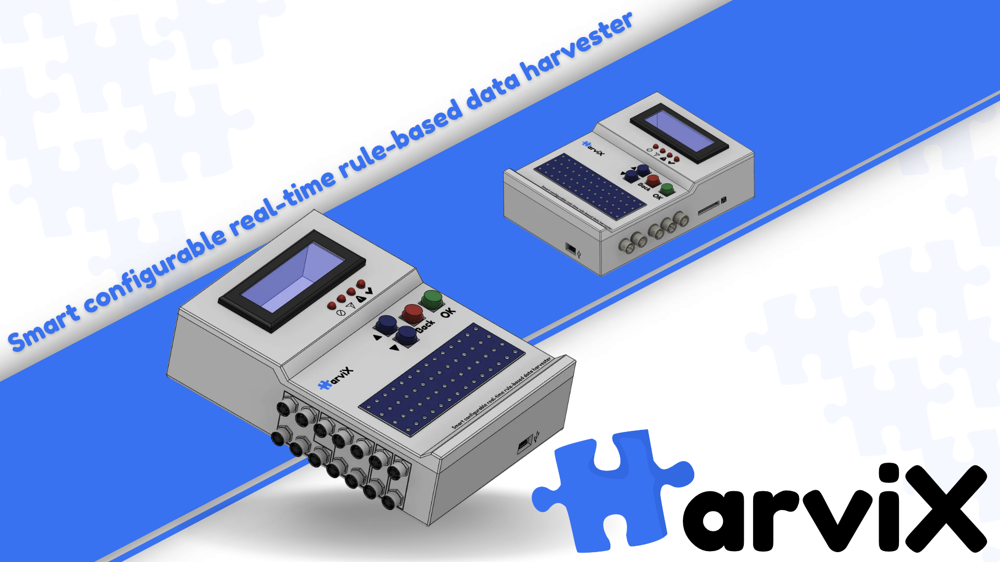
</p>

---

## Table of contents

- [Overview](#overview)
- [Features](#features)
- [Use cases](#use-cases)
- [Rule-based behavior](#rule-based-behavior)
- [Sensor drivers](#sensor-drivers)
- [Firmware architecture](#firmware-architecture)
- [HarviX Studio](#harvix-studio)
- [Hardware](#hardware)
- [Team](#team)
- [License](#license)

---

## Overview

**HarviX** is a modular, configurable data acquisition device. It reads sensors, evaluates user-defined rules in real time, and triggers actions (outputs, logging, streaming) without any reprogramming of the firmware.

**Mission**

1. Acquire data
2. Evaluate rules
3. Orchestrate flows
4. Trigger actions
5. Store / stream data

The project has two parts:

| Part | Description |
|------|-------------|
| **HarviX (device)** | Embedded unit with an LCD, buttons, status LEDs, sensor inputs, outputs, SD card and USB. |
| **HarviX Studio** | Desktop application to configure the device at runtime and visualise live data. |

## Features

- Real-time processing
- Rule engine
- Modular I/O
- SPI / I2C / ADC sensor support
- On/off outputs and PWM outputs (e.g. servos)
- SD card logging
- USB streaming to a PC
- Local user interface: LCD, 4 status LEDs, Up / Down / Back / OK buttons
- Configuration stored in flash and reloaded at boot

## Use cases

| Mode | Description |
|------|-------------|
| **Datalogger** | Sensors are sampled and written to the SD card with timestamps (date/time, level, temperature, ...). |
| **Oscilloscope** | Sensor data is streamed over USB and plotted live on the PC. |
| **Laboratory equipment** | Rules combine sensors, logging, streaming and actuators (lamp, buzzer, servo) in one setup. |

<p align="center">
  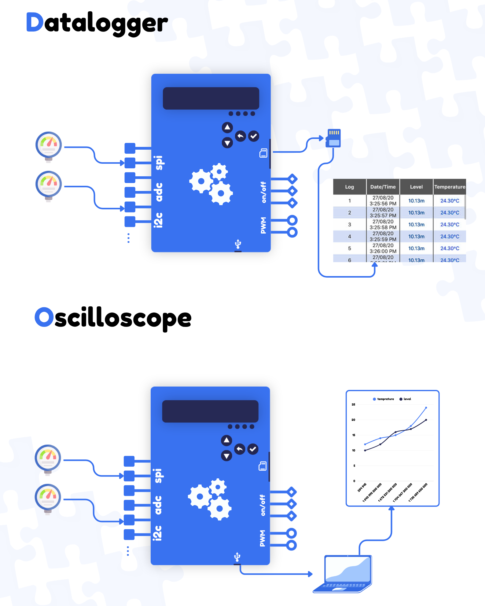
  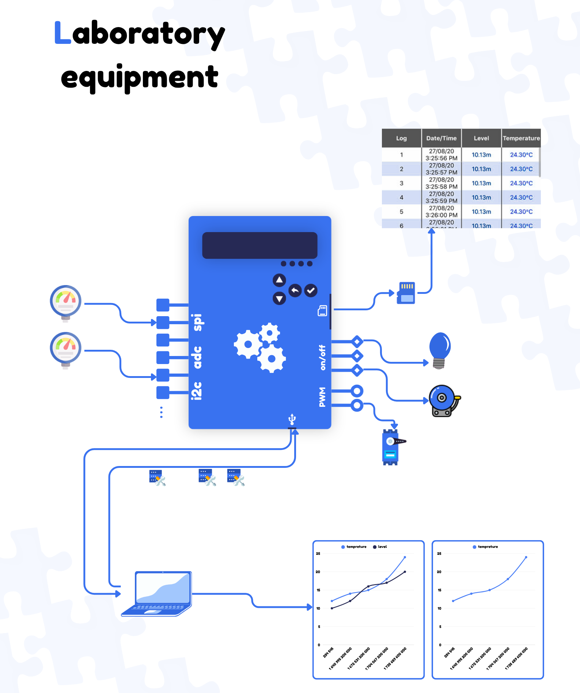
</p>

## Rule-based behavior

Rules are `IF <conditions> THEN <actions>`. Conditions can be combined with a logical **AND**.

Supported building blocks (as shown in the project):

- Comparison on the current value: `>`, `<`
- Trend analysis: `slope`
- Logical AND (`&`)
- Actions: switch an output on/off, drive PWM, **log** to SD, **stream** over USB

Example rules in Studio:

```
re1: IF current(device1) > 20.0  &  current(device2) < 100.0  =>  stream
re2: IF current(device1) < 50.0                               =>  stream
```

<p align="center">
  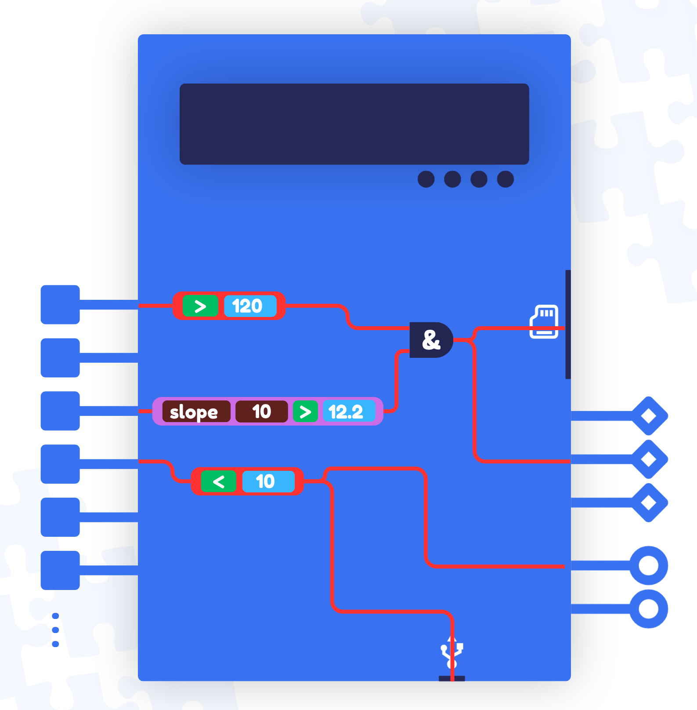
</p>

## Sensor drivers

HarviX is not limited to a fixed list of sensors. Any sensor on the available buses (SPI, I2C, ADC, digital) can be used by writing a driver for it. Drivers are plugged into the reader through a dispatch table, so the reader task never needs to change when a sensor is added.

The drivers developed and tested so far are:

| Sensor | Bus | Measured quantity |
|--------|-----|-------------------|
| **BH1750** | I2C | Luminosity (lux) |
| **NTC thermistor** | ADC | Temperature (°C) |

More drivers (for example DHT11 / DHT22 / DS18B20 on the digital slots, or SPI sensors) can be added by following the steps below.

### Adding a new sensor

1. Create `xxx_driver.h` and `xxx_driver.c`, exposing `extern const Sensor_Driver_API_t xxx_driver_api;`.
2. Add a `SENSOR_XXX` entry in `sensor_types.h`.
3. Register it in the driver table in `sensor_dispatch.c`:

```c
static const Sensor_Driver_API_t *const g_drivers[SENSOR_COUNT] = {
    [SENSOR_NONE]   = NULL,
    [SENSOR_BH1750] = &bh1750_driver_api,
    [SENSOR_NTC]    = &ntc_driver_api,
    [SENSOR_XXX]    = &xxx_driver_api,   /* new sensor */
};
```

`reader.c` does not need to be modified.

## Firmware architecture

The firmware runs on **FreeRTOS**, split into tasks that communicate through queues.

| Task | Role |
|------|------|
| **Reader** | Samples sensors according to the configuration (`conf`) and pushes data to the reader queue. |
| **Rule engine** | Evaluates the rules table against incoming data; dispatches to the actions, log and TX queues. |
| **Actions handler** | Applies actions on outputs (on/off, PWM). |
| **Logger** | Writes records to the SD card. |
| **TX** | Streams data and responses to the PC over USB. |
| **RX** | Receives commands from the PC. |
| **Commander** | Central command handler: updates `conf` and the rules table, manages the flash and the session. |
| **LCD interface** | Local UI (display + buttons); also sends commands to the Commander. |

Queues: `reader`, `actions`, `log`, `TX`, `cmds`.
Persistent storage: `conf` and `rules table` are saved to **flash** and loaded at **boot**.

<p align="center">
  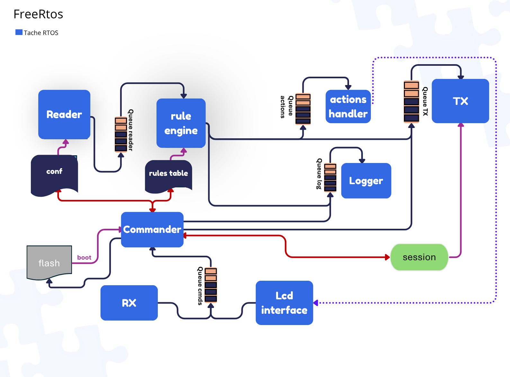
</p>

## HarviX Studio

Desktop platform for runtime configuration and live data visualisation.

**Functions:** assign sensors · create rules · real-time visualisation · monitoring.

- **Configurator**: click an input (SPI / ADC / I2C / digital) to add a sensor (model + quantity), and toggle LOG / STREAM and outputs.
- **Rule editor**: text editor and visual editor, with a "new rule" dialog (conditions + actions).
- **Visualiser**: real-time plots per rule.
- **Toolbar**: configurator/visualiser switch, clear, reload last config, save, manual/AI config switch, AI assistant, COM connection, upload config, send config, stop/start.
- **AI assistant**: describe an experiment in natural language and get a suggested configuration.

> Note: the current Studio UI is in French.

<p align="center">
  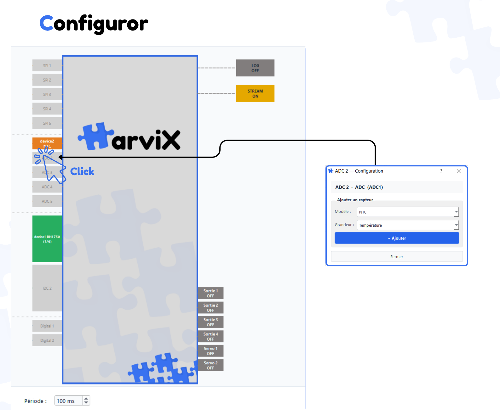
  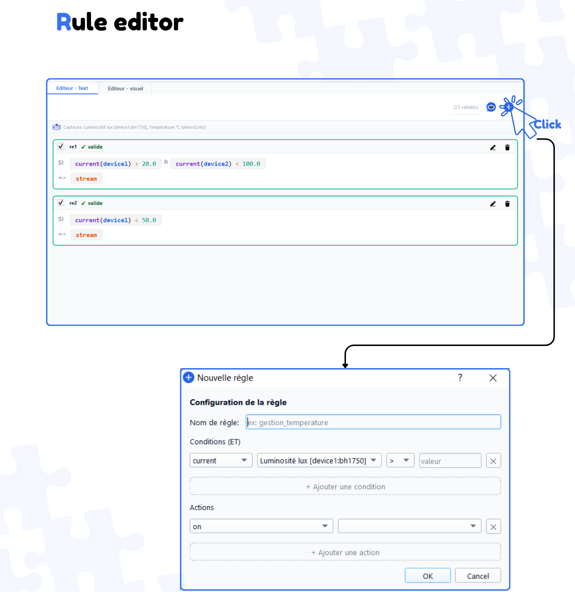
</p>
<p align="center">
  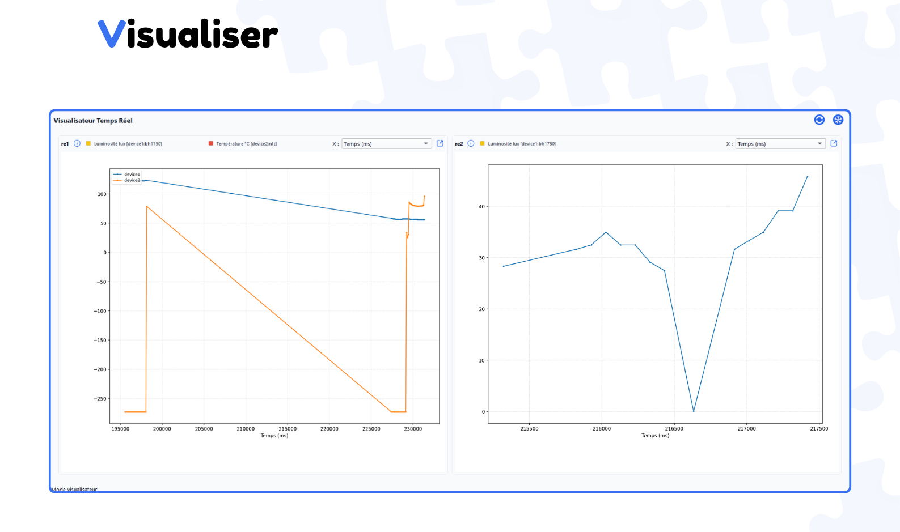
</p>

## Hardware

- Board: **STM32F429I-DISCO** (STM32F429 Discovery kit)
- Microcontroller: **STM32F429ZIT6**, ARM Cortex-M4 with FPU, up to 180 MHz, 2 MB flash, 256 KB RAM
- Display: I2C character LCD (address `0x27`) on a dedicated bus
- Inputs: **14 sensor slots** across SPI, I2C, ADC and digital (1-wire) buses
- Outputs: 4 on/off GPIO outputs + 2 PWM servo outputs
- Storage: SD card (SPI) and internal flash
- Connectivity: USB OTG CDC (main streaming) and USART1 via ST-LINK VCP (debug)
- UI: Up / Down / Back / OK buttons, status LEDs
- Enclosure: custom CAD design (files in [`hardware/enclosure`](hardware/enclosure))

### Pin allocation

The full mapping lives in [`firmware/include/board_config.h`](firmware/include/board_config.h).

**Sensor slots (14 total)**

| Slots | Bus | Pins | Notes |
|-------|-----|------|-------|
| CH1 to CH3 | SPI1 | SCK `PA5`, MISO `PA6`, MOSI `PA7` | CS: `PB0`, `PB1`, `PB2` |
| CH4 to CH5 | SPI4 | SCK `PE2`, MISO `PE5`, MOSI `PE6` | CS: `PE3`, `PE4` |
| CH6 | I2C2 | SDA `PF0`, SCL `PF1` | Up to 6 devices on the bus |
| CH7 | I2C3 | SDA `PC9`, SCL `PA8` | Up to 6 devices on the bus |
| CH8 to CH12 | ADC1 | `PA1`, `PA2`, `PA3`, `PC0`, `PC2` | Channels 1, 2, 3, 10, 12 |
| CH13 to CH14 | Digital (1-wire) | `PD14`, `PD15` | TIM4 CH3/CH4, for DHT11, DHT22, DS18B20 |

**Communication, storage and display**

| Function | Peripheral | Pins |
|----------|------------|------|
| USB streaming | USB OTG CDC | `PB14`, `PB15` |
| Debug console | USART1 (ST-LINK VCP) | `PA9`, `PA10` |
| SD card | SPI3 | SCK `PC10`, MISO `PC11`, MOSI `PC12`, CS `PD2` |
| LCD | I2C1 | SCL `PB6`, SDA `PB7` |

**Actions and user interface**

| Function | Pins |
|----------|------|
| GPIO outputs (4) | `PD1`, `PG13`, `PD3`, `PD4` |
| Servo PWM (2) | `PD12` (TIM4 CH1), `PD13` (TIM4 CH2) |
| Menu buttons Up / Down / Select / Back | `PE7`, `PE8`, `PE9`, `PE10` (input, pull-up) |
| System LEDs OK / Error | `PG13` (green), `PG14` (red) |
| User button | `PA0` |

<p align="center">
  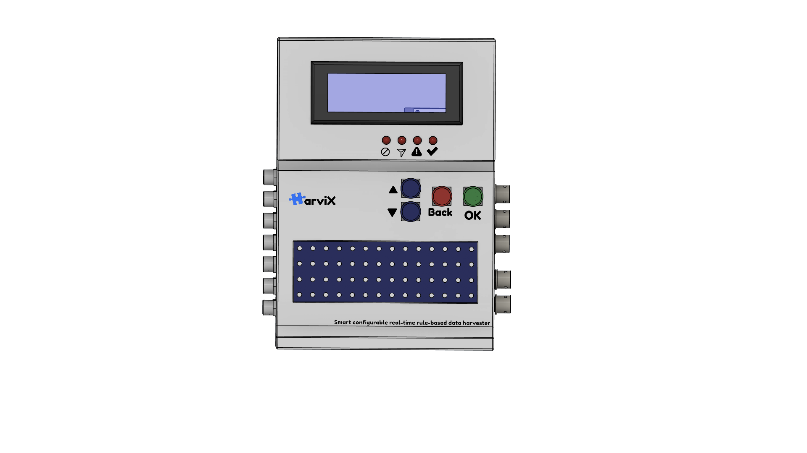
  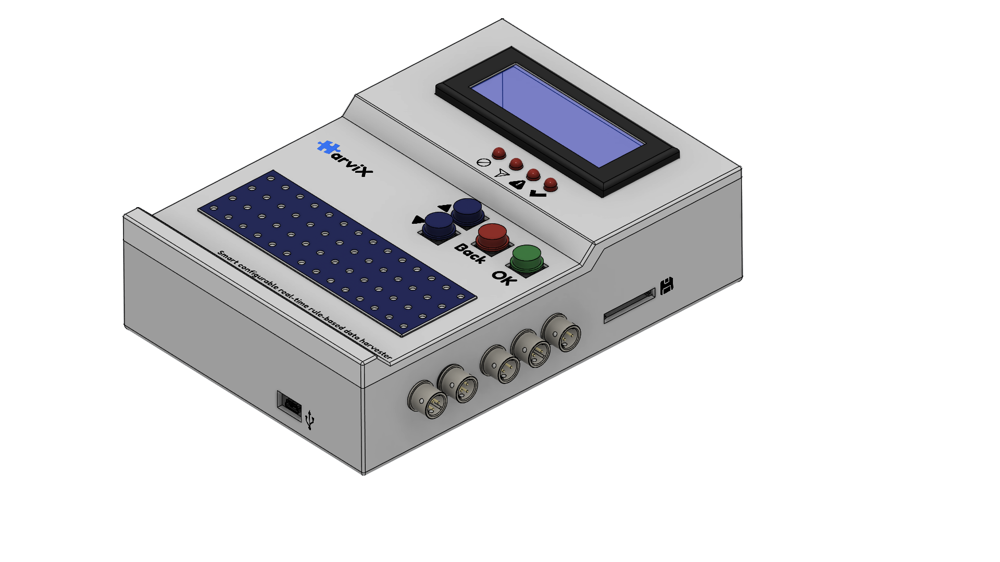
  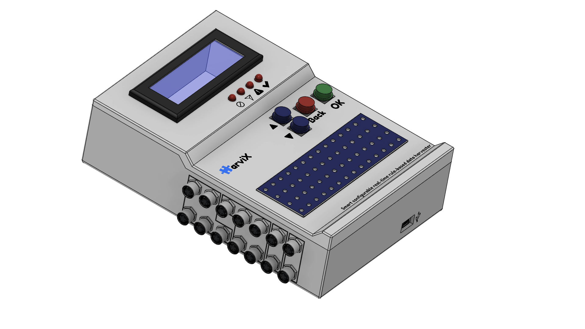
</p>

## Team

| Name |
|------|
| Hichem Belarbi |
| Samer Rebaie |
| Iskander Chaouechi |

Embedded Systems Engineering, 2nd year, end-of-term project, carried out at the **Faculty of Sciences of Tunis** (Faculté des Sciences de Tunis).

**Supervisor:** Ibtissem Maalouch
**Academic year:** 2025/2026

The project was presented at **ACTIA**.

## License

Copyright (C) 2026 Hichem Belarbi, Samer Rebaie, Iskander Chaouechi

This project is licensed under the **GNU General Public License v3.0**. You are free to use, study, modify and share it, but any distributed derivative work must also be released under the GPL v3 with its source code available. See the [`LICENSE`](LICENSE) file for the full text.
